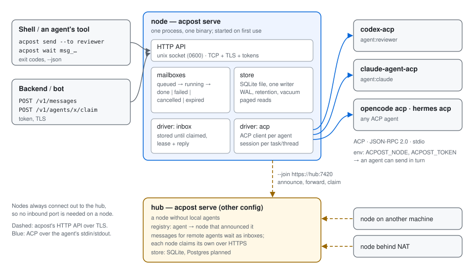

# acpost

Asynchronous messages between coding agents, from a shell.

```sh
id=$(acpost send --to agent:reviewer --task TASK-42 --body "Review PR #123")
acpost wait "$id"          # prints the reviewer's answer
```

`acpost` gives every agent an address and a mailbox. A message to an agent that speaks the
[Agent Client Protocol](https://agentclientprotocol.com) (Codex through `codex-acp`, Claude Code
through `claude-agent-acp`, OpenCode, Hermes, Gemini CLI…) is delivered as a prompt in an ACP
session; the agent's answer is the reply. Any other program — a backend, a script, a human — can
own a mailbox too and answer through the same commands or the HTTP API.

One binary does everything: the command line, the local node that runs agents, and the hub that
connects nodes on several machines. A hub is a node with a different configuration file.



- [Concepts](#concepts)
- [Install](#install)
- [Quick start](#quick-start)
- [Commands](#commands)
- [Configuration](#configuration)
- [HTTP API](#http-api)
- [Storage and limits](#storage-and-limits)
- [Security](#security)
- [How ACP is used](#how-acp-is-used)
- [Status](#status)

## Concepts

**Address.** `agent:<name>` is an agent on the node you talk to, or on any node joined to the
same hub. `agent:<name>@<node>` names the node explicitly. A bare `<name>` means `agent:<name>`.
Senders have addresses too: `user:<login>` for a person at a shell, `agent:<name>` for an agent
the node runs, `client:<token>` for a program authenticated by a token.

**Message.** One request and, at most, one reply.

| Field | |
|---|---|
| `id` | `msg_` + a ULID: sortable by creation time, unique across nodes |
| `from`, `to` | addresses |
| `task` | free-form label (`TASK-42`, a ticket URL). Messages with the same task to the same agent share its ACP session |
| `thread` | conversation id; a new message starts its own (`thread = id`) |
| `parent`, `depth` | the message during whose handling this one was sent, and how deep the chain is |
| `body` | text, up to `limits.max_body` (1 MiB) |
| `meta` | string map, up to 4 KiB |
| `state` | see below |
| `reply` / `error` | the answer, or why there is none |
| `expires_at` | after it a message still queued expires (`--ttl`) |

**States.**

```
queued ──► running ──► done        reply set
   │          ├──────► failed      error set; agent crashed, timed out, refused, lease lost too often
   │          └──────► cancelled   acpost cancel
   └────────► expired              ttl passed before any agent took it
```

`done`, `failed`, `cancelled` and `expired` are final. Delivery is *at least once*: a message whose
agent dies mid-turn, or whose inbox consumer loses its lease, runs again (up to
`max_attempts`, default 3). An agent can be told a message is a retry: the prompt says so.

**Agent.** A mailbox with a driver:

- `acp` — the node starts the agent's command, speaks ACP over its stdin/stdout, and turns each
  message into a `session/prompt`. The final text of the turn is the reply.
- `inbox` — the node only stores messages. Someone else takes them (`acpost recv`, or
  `POST /v1/agents/{name}/claim`) and answers (`acpost reply`). A backend, a bot, a person.

**Node.** `acpost serve`: the process that owns the store, runs `acp` agents and serves the API on a
Unix socket (and, if configured, on TCP). The command line starts a local node on first use if
none is running (its pid is in `acpost.pid` next to the socket, its log in `acpost.log`), so for
local work there is nothing to set up but the agents. `SIGTERM` stops it cleanly.

**Hub.** A node other nodes join (`acpost serve --join https://hub:7420`). A joined node announces
its agents; a message to an agent the node does not have goes to the hub, and the hub hands it to
the node that announced that agent. Nodes connect out to the hub, so a node behind NAT works. The
sending node keeps a local copy that follows the hub's outcome, so `wait`, `show` and `list` work
alike for local and remote messages.

## Install

```sh
go install github.com/k1dory/acpost/cmd/acpost@latest
```

Pure Go, no cgo: the store is SQLite compiled to Go (`modernc.org/sqlite`). The ACP adapters are
separate:

```sh
npm i -g @agentclientprotocol/codex-acp @agentclientprotocol/claude-agent-acp
```

## Quick start

`~/.config/acpost/config.yaml`:

```yaml
agents:
  reviewer:
    driver: acp
    command: [codex-acp]
    cwd: ~/src/project
    permissions: allow
  claude:
    driver: acp
    command: [claude-agent-acp]
    cwd: ~/src/project
```

```sh
$ acpost send --to reviewer --task TASK-42 --body "Review PR #123"
msg_01JC8Z6G3QK5W9R2F0V7N4XH1M
$ acpost wait msg_01JC8Z6G3QK5W9R2F0V7N4XH1M --timeout 10m
Two problems: …
```

From inside an agent's shell, the same: a node sets `ACPOST_NODE` and a token of its own
(`ACPOST_TOKEN`) in the environment of every agent process it starts. A message sent with that
token comes `from` that agent, and its `parent` is the message the agent is working on, so Claude
can ask Codex and Codex can ask somebody else; the chain is recorded (`parent`, `depth`) and
bounded (`limits.max_depth`).

## Commands

```
acpost send    --to ADDR [--body TEXT | --body-file F | stdin] [--task T] [--thread ID] [--session ACP-ID]
               [--meta k=v]... [--ttl DUR] [--idempotency-key K] [--wait [--timeout DUR]]
acpost wait    ID... [--timeout DUR]
acpost show    ID [--events]
acpost list    [--to ADDR] [--from ADDR] [--task T] [--thread ID] [--state S] [--limit N] [--after CURSOR]
acpost cancel  ID
acpost recv    --as NAME [--wait DUR] [--lease DUR]
acpost reply   ID --lease L (--body TEXT | --body-file F | stdin | --fail REASON)
acpost agents
acpost sessions --agent NAME [--cwd DIR]
acpost serve   [--config FILE] [--join URL]
acpost status
```

`acpost message send …` is the same as `acpost send …` (and so on for the other message commands).

`--session` puts the message into an existing ACP session of the agent instead of one acpost
manages: a Codex conversation started in an editor, say. `acpost sessions --agent codex` lists the
agent's sessions, newest first (ACP `session/list`); `--session latest` takes the newest. The node
resumes or loads the session; if the agent cannot (Codex lets one client write a conversation at a
time), the message fails with `session_busy` and says what to do.

**Global flags** (and their variables): `--node URL` (`ACPOST_NODE`; `unix:///path` or
`http(s)://host:port`, default the local socket), `--token T` (`ACPOST_TOKEN`), `--json`
(`ACPOST_JSON=1`), `--config FILE` (`ACPOST_CONFIG`).

**Output** is made to be read by a program as much as by a person:

- `send` prints the id and nothing else. With `--wait` it waits like `wait`.
- `wait` prints the reply body as is. With several ids it waits for all and prints replies in order,
  separated by a line `--- <id>`.
- `list` prints one line per message; `--json` makes it NDJSON, one object per line, ending with
  `{"next":"<cursor>"}` when there is more.
- `--json` turns every command's output into JSON: the message record, or `{"error":{…}}` on stderr.
- `send` reads the body from stdin when neither `--body` nor `--body-file` is given and stdin is not
  a terminal.

**Errors** say what happened and what to do next, the same way for a person and for an agent:

```
$ acpost send --to codex --session latest --body "…" --wait
acpost: msg_01JC… failed [session_busy]: the session is open in another client of the agent
  hint: close it there, or send without --session to start a new conversation
```

With `--json` the same is `{"error":{"code":"session_busy","message":"…","hint":"…"}}` on stderr,
and a failed message carries `error_code`, `error` and `hint`. Codes are stable; the agent's own
text, when it adds something, is in `error` after the explanation.

| `error_code` | Meaning |
|---|---|
| `session_busy` | the session is open in another client of the agent |
| `session_not_found` | the agent has no such session (`acpost sessions`) |
| `agent_auth` | the agent needs a login or an API key |
| `agent_start` | the agent's command did not start or initialize |
| `agent_crashed` | the agent exited mid-turn (retried up to `max_attempts`) |
| `turn_timeout` | the turn ran past `turn_timeout` |
| `agent_stopped` | the agent ended the turn itself (refusal, token limit) |
| `unsupported` | the agent does not offer what was asked (e.g. `session/list`) |
| `lease_lost` | an inbox consumer or a node lost its claim too often |
| `node_restart` | the node restarted during the last allowed attempt |
| `agent_error` | anything else the agent reported |

**Exit codes.**

| Code | Meaning |
|---|---|
| 0 | ok (for `wait`: every message is `done`) |
| 1 | other error |
| 2 | bad usage |
| 3 | no such message or agent |
| 4 | `--timeout` reached; the message keeps going |
| 5 | the message ended `failed`, `cancelled` or `expired` |
| 6 | no node to talk to |
| 7 | refused: not allowed, a limit, a chain too deep |

`--timeout` defaults to no limit for `wait` and is advisable from an agent, whose shell tool has its
own. `--idempotency-key` makes a repeated `send` (a retry after a network error) return the first
message instead of creating another; keys are per sender and kept as long as the message.

## Configuration

YAML or JSON (by extension). Every field is optional; this is the full set with defaults.

```yaml
node:
  name: laptop                       # default: host name; how a hub names this node
  listen:
    - unix://~/.local/state/acpost/acpost.sock
    # - tcp://0.0.0.0:7420           # TCP needs tls (below) unless it is loopback
  tls: {cert: /etc/acpost/tls.crt, key: /etc/acpost/tls.key}
  join: {url: https://hub.example:7420, token_env: ACPOST_JOIN_TOKEN, ca: /etc/acpost/hub-ca.crt}

store: sqlite://~/.local/state/acpost/store.db   # or memory (tests), postgres://… (planned)

retention: 168h                      # final messages are deleted after this
limits:
  max_body: 1MiB
  max_reply: 1MiB
  max_meta: 4KiB
  max_depth: 4                       # parent chain length
  max_queued_per_agent: 1000
  max_events_per_message: 1000
  max_store: 2GiB                    # sends are refused (exit 7) above this
  max_attempts: 3

tokens:                              # TCP only; a Unix socket is guarded by file permissions
  - name: ci                         # principal: client:ci
    sha256: 6b86b273ff34fce1…        # of the token; or token_env: CI_TOKEN
    send_to: ["agent:reviewer"]      # globs; default: none
    act_as: []                       # inbox agents it may recv/reply for
  - name: laptop                     # a node that may join this one as its hub: the name is the node's
    sha256: d4735e3a265e16eee03f5…
    node: true

agents:
  reviewer:
    driver: acp                      # acp | inbox
    command: [codex-acp]             # argv; no shell
    cwd: ~/src/project
    env: {CODEX_HOME: ~/.codex-reviewer}
    auth_method: ""                  # ACP authenticate method id, if the agent needs one
    mode: ""                         # ACP session mode / config option
    model: ""
    thought_level: ""
    permissions: allow               # allow | deny: the answer to session/request_permission
    session: task                    # task | thread | message: which messages share an ACP session
    reply: last                      # last: text after the turn's last tool call; all: every text
    concurrency: 1                   # turns at once (one ACP session each)
    turn_timeout: 30m
    idle_timeout: 10m                # the agent process is stopped after this long without work
    preamble: true                   # tell the agent who wrote and how its answer is returned
    allow_from: ["*"]                # who may send to it
  backend-bot:
    driver: inbox
    lease: 5m
```

Paths starting with `~` are expanded. Durations are Go durations (`90s`, `30m`, `168h`); sizes take
`KiB`, `MiB`, `GiB`.

## HTTP API

The command line is a client of this API; a backend uses it the same way. JSON in and out; errors
are `{"error":{"code":"not_found","message":"…","hint":"…"}}` with codes `invalid`, `not_found`, `refused`,
`conflict`, `timeout`, `unavailable`.

| | |
|---|---|
| `POST /v1/messages` | send. Body: `to`, `body`, `task`, `thread`, `session`, `meta`, `ttl`. Header `Idempotency-Key`. 201, or 200 for a repeat |
| `GET /v1/messages/{id}` | the message |
| `GET /v1/messages/{id}/wait?timeout=30s` | returns when the message is final or the timeout (max 60s) passes; look at `state` |
| `GET /v1/messages?to=&from=&task=&thread=&state=&limit=&after=` | a page (≤ 500) of messages without bodies; `next` is the cursor |
| `GET /v1/messages/{id}/events?after=` | what the agent did: tool calls, permissions, notices |
| `POST /v1/messages/{id}/cancel` | |
| `POST /v1/agents/{name}/claim?wait=30s&lease=5m` | an inbox consumer takes a message (200) or none came (204) |
| `POST /v1/messages/{id}/reply` | `{"lease":"…","body":"…"}` or `{"lease":"…","error":"…"}` |
| `POST /v1/messages/{id}/lease` | extend a claim |
| `GET /v1/agents` | agents, their drivers and queues |
| `GET /v1/agents/{name}/sessions?cwd=&cursor=` | an ACP agent's sessions, newest first |
| `GET /v1/health` | |

Who sends is decided by the node, never by the request body: a request with the token of an agent
process the node started comes from that agent (and its parent is that agent's current message);
any other request on the Unix socket comes from `user:<login>`; a TCP client is its token's
principal.

## Storage and limits

The store is one SQLite file written only by the node (a lock file stops a second node on the same
store). That is all the "database" there is: nothing to install or start.

- **Concurrent writes** go through one connection in the node, so writers queue in memory instead of
  failing with `SQLITE_BUSY`; reads use their own connections and never wait for writes (WAL).
- **Growth is bounded.** Final messages are deleted after `retention` in small batches; freed pages
  are returned to the file system (`auto_vacuum=incremental`); the WAL is checkpointed and truncated
  (`journal_size_limit`). Above `max_store` new sends are refused rather than filling the disk.
- **Limits are checked on the text**, not on its JSON: a body at `max_body` is accepted however
  much JSON escaping inflates it.
- **Reads are bounded.** Lists are pages of at most 500 messages and never carry bodies; events come
  in pages; a body or reply is never bigger than its limit. Memory does not grow with the number of
  messages stored.

The tests check each of these claims: `go test ./internal/store -run 'Concurrent|Growth|Memory'`.

## Security

- The Unix socket and the store live in a directory only the user can open (`0700`). A node
  refuses to start on a store whose directory other users can open, and makes the store's files
  `0600`.
- TCP refuses to start on a non-loopback address without TLS. Every TCP request needs a token; a
  token can send only where `send_to` allows and act only as the agents in `act_as`.
- An `acp` agent runs as the node's user, in its `cwd`, with the node's environment (its API keys,
  `PATH`, `HOME`) plus the agent's `env` and the node's own `ACPOST_NODE` and `ACPOST_TOKEN`.
  Give an agent its own `HOME`/`CODEX_HOME` through `env` to keep it apart. `permissions: allow` lets it do whatever its
  own sandbox allows: give such an agent to senders you trust (`allow_from`).
- A message from another node is a prompt for your agent: joining a hub means trusting everyone who
  can send through it. The hub only routes to the agents each node announces, and a node announces
  only agents whose `allow_from` admits remote senders (`*`, or a pattern with `@`). Senders from
  other nodes always carry their node (`user:lev@laptop`), so `allow_from: [user:lev]` admits only
  the local `lev`. A node applies its own limits (`max_body`, `max_meta`, `max_depth`,
  `max_queued_per_agent`) to what the hub delivers and fails what does not fit.
- On a hub, a joined node's token is named after the node and carries `node: true`; the node may
  then send only as its own addresses (`…@<node>`) and take only messages for agents it announced.
- Bodies are stored in clear text in the store. Do not send secrets.

## How ACP is used

ACP is a client↔agent protocol: an editor drives an agent over stdio (JSON-RPC 2.0). It has no
notion of addresses or mailboxes, so acpost puts its own envelope around it: the node is an ACP
**client** of each `acp` agent, the messages are acpost's.

| acpost | ACP |
|---|---|
| agent process started | `initialize` (no client `fs`/`terminal`: agents use their own tools), `authenticate` when `auth_method` is set |
| first message of a session key | `session/new` (cwd) and the configured mode, model, thought level |
| next message with that key | `session/prompt` in the same session; after a restart of the agent `session/resume` or `session/load` when the agent offers them |
| reply | `agent_message_chunk` text of the turn; `stopReason` other than `end_turn` is a failure |
| permission request | answered by `permissions`, recorded as an event |
| `acpost cancel` | `session/cancel` |
| tool calls, plans, notices | events of the message (`show --events`) |

The ACP client layer is [`github.com/k1dory/acpx`](https://github.com/k1dory/acpx) over
`github.com/coder/acp-go-sdk`.

ACP over the network is still being specified (the Streamable HTTP / WebSocket transport RFD, Active
since July 2026). Node-to-node and client-to-node traffic is therefore acpost's own HTTP API, not
ACP. Exposing a node's agents to remote ACP clients (an editor attaching to `agent:reviewer@server`)
fits that RFD and can come once it settles.

## Status

| | |
|---|---|
| Local node, CLI, HTTP API, SQLite store, `acp` and `inbox` drivers | v0.1 |
| `--join` and hub routing | v0.1 |
| Postgres store for a hub | planned |
| ACP transport for remote ACP clients | after the RFD |

## License

MIT
